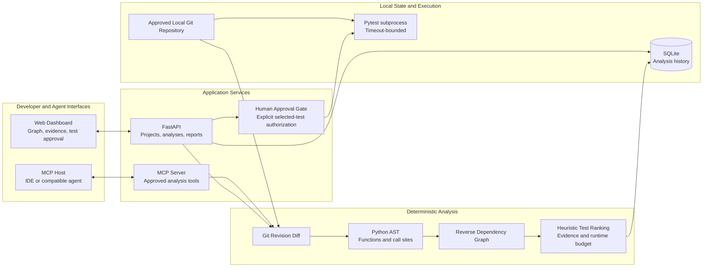

# ChangeScope MCP - Deterministic Code Change Impact Analysis

A developer-facing Web Application and Model Context Protocol server that replaces LLM guesswork with deterministic AST call-graph traversal, Git diff inspection, and human-gated regression test prioritization.

## Why Web + MCP?

Code review, diff inspection, dependency exploration, and regression test approval fit desktop developer workflows and AI coding tools. ChangeScope pairs an interactive web dashboard with MCP tools so developers and agents can query the same deterministic analysis. Static analysis provides explainable evidence; test execution remains behind an explicit human approval gate.

## Architecture



## Features

- Interactive reverse-dependency impact graph
- Python AST function and call-site analysis
- Git revision diff analysis, including deleted functions
- Deterministically ranked pytest targets
- Explicit human approval before test execution
- MCP tools for approved repository analysis

## Quickstart

```bash
chmod +x run.sh
./run.sh
```

Open `http://localhost:8000`.

On first boot, the application creates `sample_repo/` with two commits and a pytest suite.

To inspect the standalone MCP server:

```bash
source .venv/bin/activate
mcp dev backend/mcp_server.py
```

## MCP Tools

- `list_approved_repositories`
- `analyze_revision_impact`
- `get_prioritized_tests`
- `explain_impact_path`

## Limitations

- Advisory predictions only; affected code is not necessarily broken code.
- Python AST analysis handles direct calls and module-level functions.
- Dynamic dispatch is marked unresolved.
- Test execution requires explicit approval in the Web UI.
- Intended for local, single-user use with approved Python repositories.
